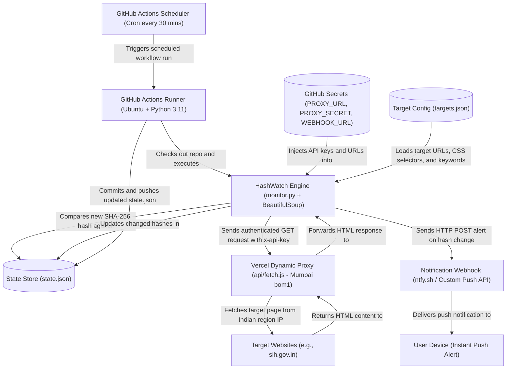

# HashWatch

A serverless, multi-site web monitoring engine powered by **GitHub Actions** and a **Mumbai-pinned Vercel proxy**. HashWatch tracks specific CSS sections of any website using SHA-256 hashing and fires instant push alerts only when actual content changes occur.


---

## Architecture



---

## Features

- **Multi-Site Configuration:** Monitor unlimited websites from a single `targets.json` file without modifying Python code.
- **Authenticated Regional Proxy:** Routes requests through a private Vercel serverless function (`api/fetch.js`) pinned to Mumbai (`bom1`) and locked with an `x-api-key` header to bypass geo-blocks safely.
- **CSS Selector Targeting:** Hash only specific sections of a page (e.g., `#announcements`, `.price`) to avoid false alarms from ads or timestamps.
- **Silent Baseline Initialization:** Automatically records the initial hash for newly added targets without triggering a false alert.
- **Zero-Spam Change Detection:** Compares SHA-256 fingerprints against `state.json` and alerts only when content actually changes.
- **Pluggable Notifications:** Works with `ntfy.sh`, Discord, Slack, or a self-hosted private push service via `WEBHOOK_URL`.

---

## Project Structure

```text
.
├── .github/
│   └── workflows/
│       └── watch.yml      # Cron schedule, Python setup, and auto-commit workflow
├── api/
│   └── fetch.js           # Authenticated dynamic proxy (Vercel serverless function)
├── vercel.json            # Pins Vercel compute region to Mumbai (bom1)
├── targets.json           # List of websites, CSS selectors, and keywords to watch
├── monitor.py             # Core scraping, hashing, and alerting engine
├── state.json             # Auto-generated JSON store of last known SHA-256 hashes
└── README.md
```

---

## Setup Guide

### 1. Deploy the Dynamic Proxy (Vercel)
1. Import this repository into [Vercel](https://vercel.com).
2. Go to **Settings → Environment Variables** and add:
   - **Key:** `PROXY_SECRET`
   - **Value:** A strong random string (e.g., `hw_secret_98234`)
3. Deploy the project. `vercel.json` automatically pins the proxy to Mumbai (`bom1`).

### 2. Configure GitHub Secrets & Permissions
1. Go to **Settings → Secrets and variables → Actions → New repository secret** and add:
   - `PROXY_URL`: `https://<your-vercel-app>.vercel.app/api/fetch`
   - `PROXY_SECRET`: The exact same secret set in Vercel
   - `WEBHOOK_URL`: Your notification endpoint (e.g., `https://ntfy.sh/your-topic` or custom Push API)
2. Go to **Settings → Actions → General → Workflow permissions**, select **Read and write permissions**, and click **Save**.

### 3. Initialize & Test
1. Go to the **Actions** tab → **HashWatch Monitor** → **Run workflow**.
2. The first run silently saves the baseline hash into `state.json`.
3. To test notifications, edit any single character in `state.json`, commit, and trigger **Run workflow** again.

---

## Adding New Targets

Edit `targets.json` and append a new object:

```json
[
  {
    "name": "SIH 2026",
    "url": "[https://www.sih.gov.in/](https://www.sih.gov.in/)",
    "selector": "body",
    "keywords": ["shortlisted", "grand finale 2026", "results out"],
    "use_proxy": true
  },
  {
    "name": "Example Portal",
    "url": "[https://example.com/updates](https://example.com/updates)",
    "selector": "#latest-news",
    "keywords": ["released", "notice"],
    "use_proxy": false
  }
]
```

- Set `"use_proxy": false` for websites that do not block GitHub Actions IPs.
- Set `"selector"` to any valid CSS selector (defaults to `"body"`).
